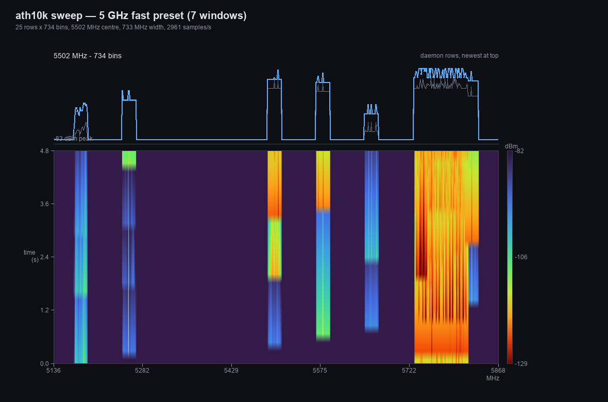

# openwrt-spectral

APK feed + sources for a live Wi-Fi spectrum analyzer on OpenWrt, driven by the
**ath10k spectral scan** FFT engine.

<p align="center">
  <a href="https://fmu.github.io/openwrt-spectral/#screens">
    
  </a><br>
  <em>5 GHz fast sweep — seven 80&nbsp;MHz windows stitched into one panorama
  (live FFT data from a QCA4019 radio).</em>
</p>

* Documentation and screenshots: <https://fmu.github.io/openwrt-spectral/>
* Main feed (daemon + LuCI app):
  `https://fmu.github.io/openwrt-spectral/arm_cortex-a7_neon-vfpv4/packages.adb`
* Extra feed (spectral-enabled ath10k kmod, kernel-specific):
  `https://fmu.github.io/openwrt-spectral/kmods/6.12.112-1-1ef2780854971e23a655b05e5b5c3630/packages.adb`

| package | contents |
|---|---|
| `spectrald` | C daemon: reads `spectral_scan0` from debugfs, converts FFT frames to dBm, serves rows over a ubus object `spectral` |
| `luci-app-spectral` | LuCI view **Status → Spectrum**: canvas waterfall, max-hold trace, auto dBm range, single-channel and sweep modes |
| `kmod-ath10k-ct` (extra feed) | ath10k-ct driver rebuilt with `CONFIG_ATH10K_SPECTRAL`; replaces the stock kmod, kernel-version specific |

## Requirements

* OpenWrt 25.12.x on `ipq40xx/generic` (`arm_cortex-a7_neon-vfpv4`).
* **A spectral-enabled ath10k driver.** The stock OpenWrt kmod is built without
  `CONFIG_ATH10K_SPECTRAL`, so `debugfs/.../ath10k/spectral_scan0` does not
  exist.  Either use the extra kmod feed below, or build an image with

  ```
  CONFIG_PACKAGE_ATH_DEBUG=y
  CONFIG_PACKAGE_ATH_SPECTRAL=y
  CONFIG_PACKAGE_MAC80211_DEBUGFS=y
  ```

  The 25.12 kernel already has `CONFIG_RELAY=y`, so only the kmod needs a
  rebuild — not the kernel.
* `iw` (sweep mode triggers per-channel scans with it).
* SSH access as `root`.
* The repository's ECDSA P-256 public key, authorized once in
  `/etc/apk/keys/` (the install steps below do this).

## Install (main feed)

The feed indexes are signed with the project's ECDSA P-256 key; each package is
verified against the checksums covered by the signed index.  Authorize the key
once; then `apk` verifies downloads without `--allow-untrusted`.

```sh
wget -O /etc/apk/keys/openwrt-spectral.pem \
  "https://fmu.github.io/openwrt-spectral/openwrt-spectral.pem"
echo "https://fmu.github.io/openwrt-spectral/arm_cortex-a7_neon-vfpv4/packages.adb" \
  >> /etc/apk/repositories.d/customfeeds.list
apk update
apk add --upgrade spectrald luci-app-spectral
```

Then open **LuCI → Status → Spectrum**.

### Signature & trust

The public key is published at the site root and has SHA-256
`a5106a64bdff0112e53a63bbc870fa2180c60800c2958a813c64b8e2d883c358`:

```sh
sha256sum /etc/apk/keys/openwrt-spectral.pem
```

The private key is only a GitHub Actions secret (`APK_SIGN_KEY`); the same key
signs both feed indexes.  The public key is in `keys/` in this
repository.  To stop trusting the feed again:

```sh
sed -i '\#fmu.github.io/openwrt-spectral#d' /etc/apk/repositories.d/customfeeds.list
rm -f /etc/apk/keys/openwrt-spectral.pem
apk update
```

## Extra feed: spectral-enabled kmod

> **Warning.** This replaces the stock `kmod-ath10k-ct` with a build that
> enables spectral scan.  It is tied to **one exact kernel**
> (`6.12.112`, OpenWrt kernel ABI `1ef27808…`), is not an upstream OpenWrt
> package, and can break Wi-Fi if the module or kernel do not match.  Keep
> Ethernet access to the router and read the recovery steps first.

```sh
# the key from the main install above is used for this feed too
echo "https://fmu.github.io/openwrt-spectral/kmods/6.12.112-1-1ef2780854971e23a655b05e5b5c3630/packages.adb" \
  >> /etc/apk/repositories.d/customfeeds.list
apk update
apk add --upgrade kmod-ath10k-ct
reboot
```

Do **not** unload/reload the ath10k modules while hostapd is running: a hot
`rmmod`/`insmod` was observed to leave the 5 GHz AP unable to start until a
reboot (2.4 GHz stayed up).  A reboot loads the module cleanly.

Verify after reboot:

```sh
ls /sys/kernel/debug/ieee80211/phy*/ath10k/spectral_scan0
ubus call spectral status
```

### Recovery: restore the upstream kmod

A copy of the official OpenWrt kmod (spectral disabled) is published next to
the feed:

```sh
wget -O /tmp/kmod-stock.apk \
  "https://fmu.github.io/openwrt-spectral/kmods/stock/kmod-ath10k-ct-official-6.12.112.2025.12.01~bb84e159-r1.apk"
apk del kmod-ath10k-ct
apk add /tmp/kmod-stock.apk
reboot
```

The stock kmod is signed by OpenWrt's release key, which a standard image
already trusts.  If your image does not have it, use `--allow-untrusted` for
this local file only.

Official copy:
<https://downloads.openwrt.org/releases/25.12.6/targets/ipq40xx/generic/kmods/6.12.112-1-1ef2780854971e23a655b05e5b5c3630/kmod-ath10k-ct-6.12.112.2025.12.01~bb84e159-r1.apk>

If Wi-Fi is down and SSH unreachable, connect a computer to a **LAN port** and
SSH to `192.168.1.1`, then run the commands above.  If the router does not
answer, use OpenWrt failsafe mode or reinstall the stock image via
`sysupgrade`.

## Usage

```sh
ubus call spectral status

# live waterfall of the serving channel (phy0 = 2.4 GHz, phy1 = 5 GHz)
ubus call spectral start '{"phy":1,"bins":256}'

# channel sweep (panorama)
ubus call spectral start '{"phy":0,"bins":64,"mode":"sweep","preset":"2g"}'
ubus call spectral start '{"phy":1,"bins":256,"mode":"sweep","preset":"5g"}'
ubus call spectral start '{"phy":1,"bins":256,"mode":"sweep","preset":"5g-fast"}'
ubus call spectral start '{"phy":1,"bins":256,"mode":"sweep","freqs":"5180 5260 5500 5745 5825"}'

ubus call spectral get '{"cursor":0}'
ubus call spectral stop
```

`get` returns `{cols, freq, width, rows, data:[u16 …]}` where `data` is a flat
row-major array of dBm+128 values; the waterfall is rendered client-side.

## Modes and caveats

* **channel** — continuous FFT samples of the serving channel (no channel
  changes).  Best for a live waterfall of your own AP channel.
* **sweep** — sequentially scans the channels in the preset and stitches the
  per-channel FFTs into one panorama (2.4 GHz ch 1–13, 5 GHz ch 36–165, a fast
  seven-window 5 GHz preset, or a custom frequency list).  Each scan briefly
  takes the radio off its serving channel; clients may notice short
  interruptions and throughput drops while sweeping.  Rows fade by 1 dB so the
  waterfall shows the sweep in progress.
* Spectral samples are for the **current channel only**; sweep is how a wider
  band is covered.  There is no "all bands at once".
* Bin values are firmware-estimated dBm — relative/interference use, not
  calibrated measurements.
* The daemon stops itself 60 s after the last `get` poll.
* 64 bins is invalid at 80 MHz; use 128 or 256.

## Build / publish

The `build` workflow builds both userspace packages with the official OpenWrt
25.12.6 SDK for `ipq40xx/generic`, signs both feed indexes with the repository
key, and deploys `public/` to the `gh-pages` branch (GitHub Pages).  The kmod
binary is committed under `feeds/kmods/` (see
[`feeds/kmods/README.md`](feeds/kmods/README.md) for provenance and the rebuild
recipe) and indexed by the same workflow.

Signing setup: the private key is the `APK_SIGN_KEY` Actions secret; the public
key is committed as `keys/openwrt-spectral.pem` and served at
`/openwrt-spectral.pem`.  Both `packages.adb` indexes are signed with
`apk mkndx --sign-key`; this is the same model as openwrt-usque.

Repository layout:

| Path | Contents |
|---|---|
| `packages/spectrald/` | daemon source, procd init, OpenWrt Makefile |
| `packages/luci-app-spectral/` | LuCI JS view, menu, rpcd ACL, Makefile |
| `feeds/kmods/` | spectral-enabled kmod apk, stock recovery apk, build notes |
| `docs/` | static GitHub Pages site (screenshots in `docs/img/`) |
| `keys/openwrt-spectral.pem` | public feed-signing key (private key is a CI secret) |
| `.github/workflows/build.yml` | SDK build, index signing, feed assembly, Pages deployment |

## License

* `spectrald` and `luci-app-spectral`: **MIT**.
* `kmod-ath10k-ct`: **GPLv2** (OpenWrt/Candela ath10k-ct driver build); source
  links and build recipe in `feeds/kmods/README.md`.
* The ath10k driver and firmware are not authored by this project.

Not affiliated with Qualcomm Atheros or the OpenWrt project.
